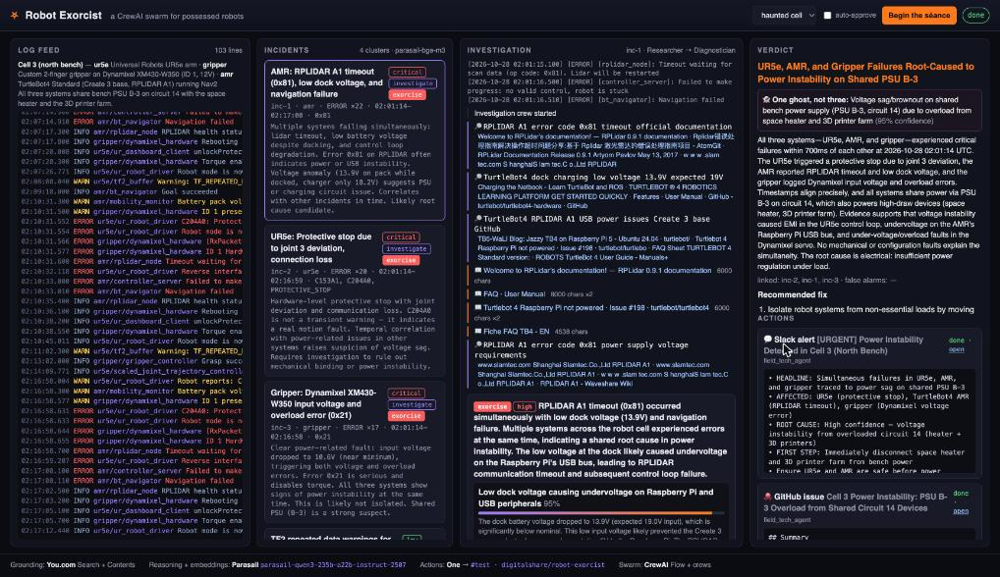
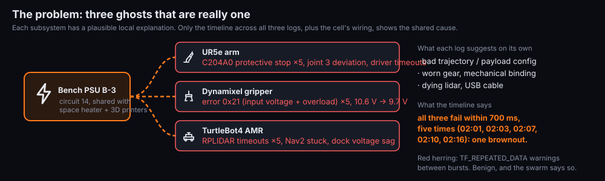
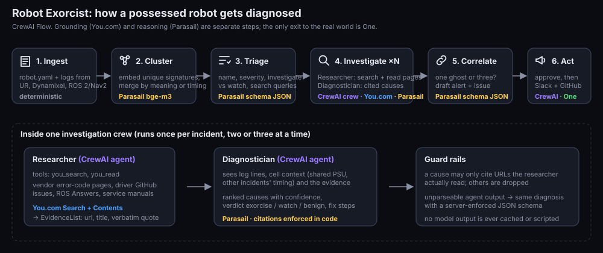

# Robot Exorcist

> Your robot is acting possessed at 2 a.m. Feed its logs to a swarm. It finds the demon, cites the scripture, and files the ticket.

Built at **Hack with YOU: Halloween Edition** (Track 3, The Open Haunt) with CrewAI, You.com, Parasail and One.



*A real run on `samples/haunted_cell`: three incidents investigated with cited sources, one shared root cause (PSU brownout, 95% confidence), the Slack alert posted and [the GitHub issue opened](https://github.com/digitalshare/robot-exorcist/issues/5) through One.*

## The problem



A lab robot cell starts misbehaving overnight: the UR5e arm protective-stops mid-path, the Dynamixel gripper throws overload errors, the AMR's lidar keeps timing out. Three subsystems, three vendors, three log formats, one tired on-call engineer. Each symptom has a plausible local explanation (bad trajectory, worn gear, dying lidar). The real cause is often shared and invisible from any single log.

Robot Exorcist reads every log, turns them into incidents, researches each one against the real documentation and forum threads, reasons to a cited diagnosis, correlates the incidents into one root cause, and then does what an engineer would do: posts the alert to Slack and opens the GitHub issue with the fix checklist.

## How the swarm works



```
samples/*.log ─► parse ─► cluster (Parasail embeddings, cosine agglomerative) ─► incident candidates
                                                                                      │
   CrewAI Flow:  triage (Parasail JSON) ─► investigate: one crew per incident ─► correlate (Parasail JSON) ─► approve ─► act
                                             Researcher  (You.com search + read)                               Field Tech agent
                                             Diagnostician (Parasail, cited)                                    (One MCP → Slack, GitHub)
                                                                                      │ events
                                       FastAPI + WebSocket console: logs → incidents → evidence → verdict → actions
```

1. **Ingest and cluster.** WARN+ lines are normalised (numbers, hex, paths stripped), each unique signature is embedded once with Parasail, and signatures are agglomerated per subsystem into incident candidates.
2. **Triage.** One schema-locked Parasail call names each incident, scores severity, decides *investigate* vs *watch*, and writes the search queries an expert would type.
3. **Investigate.** For every incident a two-agent CrewAI crew runs (concurrency-limited): the **Researcher** searches You.com and reads the pages (vendor docs, GitHub issues, ROS Answers) and returns verbatim quotes; the **Diagnostician** ranks causes with confidence, cites only URLs the researcher actually read (enforced in code), sets a verdict (`exorcise` / `watch` / `benign`) and writes fix steps.
4. **Correlate.** The incident commander step looks across all diagnoses and the timeline: are these one ghost or three? It produces the headline, the shared root cause (or none), false alarms, and drafts the Slack alert and the GitHub issue.
5. **Act.** After approval in the console (or `--auto`), the **Field Tech** agent posts the alert and opens the issue with two tools, `post_slack_alert` and `open_github_issue`. Each tool drives One's MCP server (`find_one_actions` → `execute_one_action`) and returns One's real response, which the flow records as the result. The agent cannot invent a URL: only what One returned is shown. If the agent trips, a deterministic executor drives the same One tools.

Nothing in the output is scripted: swap in different logs (`samples/stuck_joint`) and the swarm tells a different story.

## 3D story mode (for people who do not speak robot)

Press **3D story** in the console, or open `http://127.0.0.1:8700/story?scenario=samples/haunted_cell`. A stylized model of the cell is built from `robot.yaml` (arm, gripper, rover, the shared power supply and its cables) and the scenario's log is replayed on a scrubber with plain-language captions: the arm freezes on a protective stop, the gripper's voltage sags and its motor trips, the rover's laser goes silent, the power supply flickers on every burst. When a run is in progress or finished, the story adds the swarm's chapters: a callout above each robot with its cited diagnosis, glowing cables and a ghost on the power supply when the verdict names one shared cause (or one ghost per robot when it does not), and chips with the Slack and GitHub links once the actions are done.

The scene code is generic. Each scenario carries its own narrative in a `story` block in `robot.yaml`: `cues` match log lines (`match` substring or `/regex/`, optional `system`) to an `effect` (`freeze`, `tremble`, `voltage`, `stop_spin`, `halt`, `flicker`, `collide`, `overrange`, `recover`, …) and a caption (`{value}` is replaced by the number in the line), plus `chapters` for the investigation, verdict and actions. A test checks that every cue matches at least one real log line, so captions cannot drift from the fixtures. Three.js is vendored under `exorcist/static/vendor`, so story mode works offline.

## Why each partner is load-bearing

| Partner | What it does here | Remove it and… |
|---|---|---|
| **CrewAI** | The Flow (`exorcist/flow.py`), an investigation crew per incident, the Field Tech crew, MCP tool wiring | there is no swarm; one model call would have to guess everything |
| **You.com** | Search + Contents are the Researcher's only tools; every citation in a diagnosis comes from a page it read | diagnoses have no evidence; the citation check strips them to zero |
| **Parasail** | All reasoning (CrewAI `LLM` on the OpenAI-compatible API), embeddings for clustering, server-enforced JSON schemas for triage, diagnosis and verdict | nothing clusters, nothing reasons |
| **One** | The only path to Slack and GitHub (`@withone/mcp` over stdio behind the Field Tech's tools and the fallback executor) | the exorcism never leaves the terminal |

## Run it

Requirements: [uv](https://docs.astral.sh/uv/), Node.js (for `npx @withone/mcp`), Python 3.12 or 3.13 (uv fetches it).

```bash
cp .env.example .env     # fill in YDC_API_KEY, PARASAIL_API_KEY, ONE_SECRET, GITHUB_REPO, SLACK_CHANNEL
./demo.sh                # installs, starts the console on http://127.0.0.1:8700 and opens it
```

Then pick a scenario, press **Begin the séance**, watch the panels fill, and approve the actions.

Other entry points:

```bash
uv run exorcist smoke                               # one real call per partner; lists Parasail models and One connections
uv run exorcist run samples/haunted_cell --auto     # whole pipeline in the terminal, actions auto-approved
uv run exorcist run samples/stuck_joint             # a different fault, a different story
uv run pytest                                       # parsers, clustering (offline fake embedder), schemas
```

### Environment

| Variable | Purpose |
|---|---|
| `YDC_API_KEY` | You.com Search + Contents (`X-API-Key`) |
| `PARASAIL_API_KEY`, `PARASAIL_MODEL`, `PARASAIL_EMBED_MODEL` | Parasail inference and embeddings; defaults `parasail-qwen3-235b-a22b-instruct-2507` and `parasail-bge-m3` |
| `PARASAIL_RPM` | client-side throttle (free keys: 5, paid: 500) |
| `ONE_SECRET` | One API key for `@withone/mcp`; optional `ONE_CONNECTION_KEYS` pins Slack/GitHub connections |
| `SLACK_CHANNEL`, `GITHUB_REPO` | where the Field Tech posts and files |
| `EXORCIST_CONCURRENCY` | investigation crews in flight (lower it on a 5 RPM key) |

## Scenarios

- `samples/haunted_cell/`: UR5e + Dynamixel gripper + TurtleBot4/Nav2 sharing one bench PSU. Five waves of simultaneous faults across all three, plus a harmless `TF_REPEATED_DATA` warning as a false-alarm test.
- `samples/stuck_joint/`: a single UR5e/MoveIt cell with `START_STATE_IN_COLLISION` planning failures and an out-of-range wrist joint. No shared cause to find.

Add your own: a folder with `robot.yaml` (cell, power, systems with `id`, `kind`, `controller`, `log`) and the logs. Lines in `[ts] [LEVEL] [node]: text` or ROS 2 console format are parsed; anything else is kept as INFO.

## Layout

```
exorcist/logs.py      parsing, normalisation, signatures
exorcist/cluster.py   embeddings → incident candidates
exorcist/parasail.py  schema-locked chat + embeddings, retry, RPM throttle
exorcist/you.py       search / contents (page cache on disk; model outputs are never cached)
exorcist/tools.py     CrewAI tools: you_search / you_read (You.com), post_slack_alert / open_github_issue (One)
exorcist/crew.py      investigation crew, field tech crew, citation enforcement
exorcist/flow.py      CrewAI Flow + event bus
exorcist/one_exec.py  One MCP client: action discovery, execution, result parsing
exorcist/server.py    FastAPI console; exorcist/static/ the UI (app.js console, story.js 3D story, icons.js)
```

## Limits

Logs are read from files (or `POST /ingest` for extra lines); there is no ROS bag reader yet. Clustering is per subsystem with a fixed cosine threshold. Open-model tool calling occasionally stalls; the investigation step reports a failed incident rather than inventing one.
